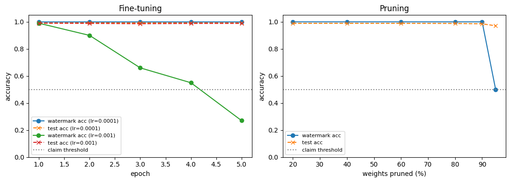

# When does ML trust evidence expire? A small watermark pilot

A model owner releases a model and keeps two pieces of evidence about it:

* **Hash evidence:** a SHA-256 hash of all weights. It answers "is this exactly the model I released?"
* **Watermark evidence:** a 100-image trigger-set watermark (Adi et al., USENIX Security 2018). The ownership claim holds if at least 50% of the triggers get their secret label.

Someone then fine-tunes or prunes the model. **Which piece of evidence still says something true about the changed model?**

This is a first, small-scale step towards studying how long ML property evidence (hashes, watermarks, attestations) stays valid after a model is transformed.

## Setup

* MNIST. The owner trains on 50,000 images; 10,000 other images play the role of someone else's data.
* Small CNN (2 conv + 2 linear layers). The watermarked model M0 is trained with the trigger set mixed in.
* Fine-tuning on the other data with lr = 1e-4 and lr = 1e-3, re-checked after each of 5 epochs.
* Global L1 magnitude pruning at 20, 40, 60, 80, 90 and 95% of weights.
* False-claim check: 3 models trained independently without the triggers.

## Results

| Group | Models | Hash matches M0 | Ownership claim holds |
|---|---|---|---|
| Original M0 | 1 | yes | yes (watermark 1.00) |
| Fine-tune, lr = 1e-4, epochs 1–5 | 5 | no | yes in 5/5 |
| Fine-tune, lr = 1e-3, epochs 1–5 | 5 | no | yes in 4/5; fails at epoch 5 (watermark 0.27, test acc 98.85%) |
| Prune 20–90% | 5 | no | yes in 5/5 |
| Prune 95% | 1 | no | yes, exactly at the threshold (50/100) |
| Independent models | 3 | no | no (watermark 0.11–0.14) |

Main observations:

1. The hash stopped matching after all 16 transformations, while the watermark still supported the claim in 15 of them.
2. Fine-tuning with lr = 1e-3 removed the watermark while test accuracy stayed at about 98.9%: the model stays useful, but the ownership evidence silently stops holding.
3. At 95% pruning the claim sat exactly on the threshold, so the threshold choice alone decided the verdict.
4. No independent model passed. The binomial probability that a uniformly guessing model reaches 50/100 is 5.83e-24, but real models are not uniform guessers, so the measured values are the more meaningful check.

Per-model values are in [`results.csv`](results.csv) (the notebook also writes the full hash per model when re-run).

## Limitations

One small dataset, one architecture, one watermarking scheme, three independent models, no adaptive attacker and no model extraction. It is a pilot, not a benchmark.

## Run it

Open `watermark_pilot.ipynb` in Google Colab and run all cells. The shown outputs come from one run on a CPU runtime; a GPU runtime is faster. Seeds are fixed.

## Note on how this was made

I am new to PyTorch (started in October 2026). I wrote this pilot with the help of an AI assistant (Claude), which drafted the code. I ran it myself, worked through every cell line by line until I could explain it, and checked the results against the outputs.

## References

* Y. Adi, C. Baum, M. Cisse, B. Pinkas, J. Keshet. *Turning Your Weakness Into a Strength: Watermarking Deep Neural Networks by Backdooring.* USENIX Security 2018.
* J. Liu, R. Zhang, S. Szyller, K. Ren, N. Asokan. *False Claims against Model Ownership Resolution.* USENIX Security 2024.
